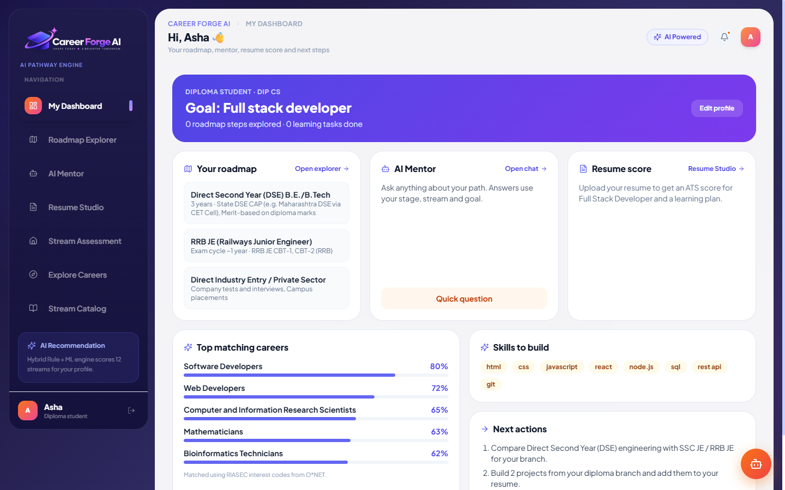
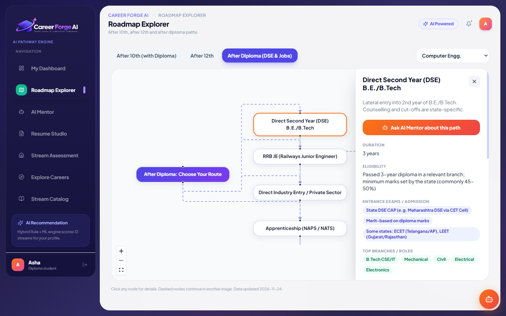
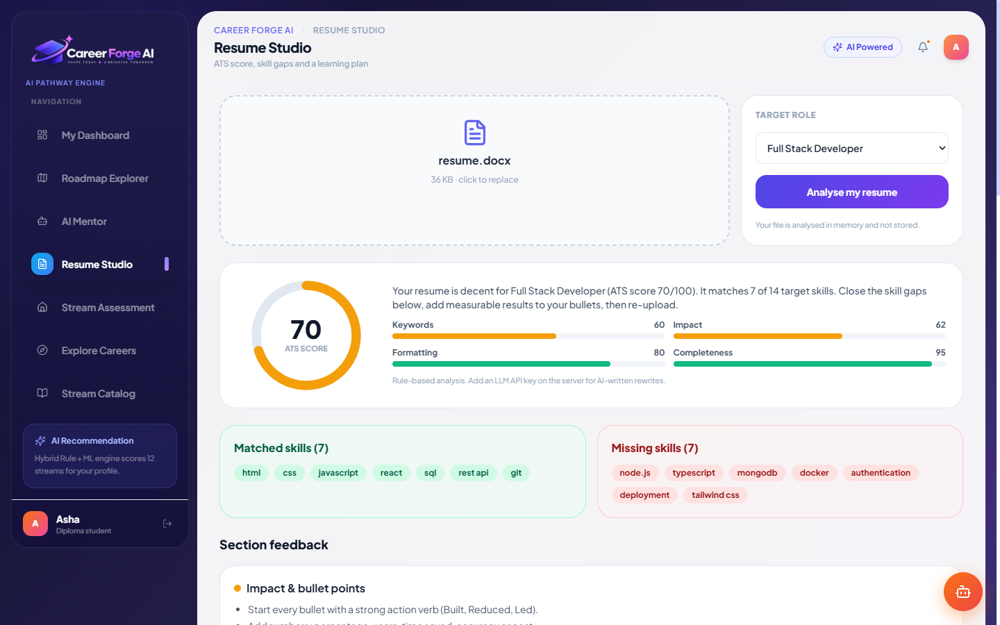
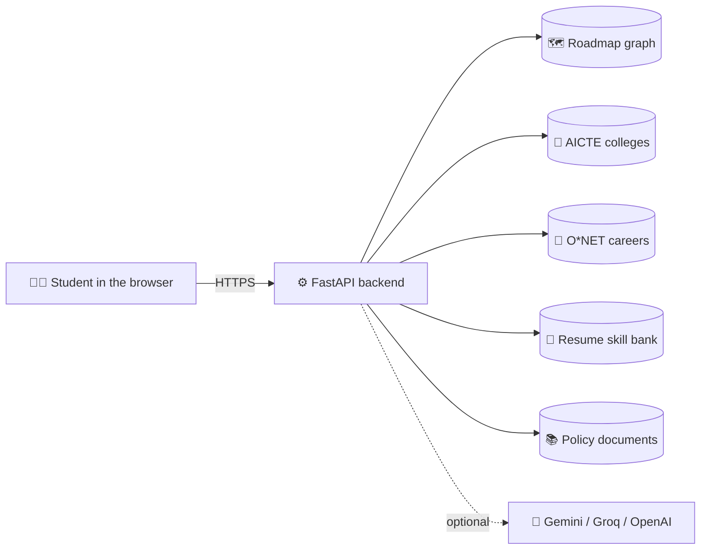

<div align="center">


# Career Forge AI

### Your career path after 10th, 12th or Diploma, on one map, with an AI mentor.

Explore every route, find AICTE colleges, ask questions and get your resume ATS-ready.

<br />

<a href="https://career-forge-ai-yprq.netlify.app/"></a>
&nbsp;
<a href="https://career-copilot-api-lw76.onrender.com/docs"></a>
&nbsp;
<a href="docs/ARCHITECTURE.md"></a>

<br /><br />


<br />



</div>

<br />

## ✨ What you can do

<table>
  <tr>
    <td width="50%" valign="top">
      <h3>🗺️ Explore every path</h3>
      <p>An interactive map of 37 steps after 10th, after 12th and after a diploma. Filter by your stream and click any step to see duration, eligibility, entrance exams, salary, official links and matching colleges.</p>
    </td>
    <td width="50%" valign="top">
      <h3>🤖 Ask the AI Mentor</h3>
      <p>Ask about any step and get an answer based on your profile and official policy notes, with the sources listed. It works without an API key and gives fuller answers once you add one.</p>
    </td>
  </tr>
  <tr>
    <td width="50%" valign="top">
      <h3>📄 Fix your resume</h3>
      <p>Upload a PDF or DOCX, choose a target role and get an ATS score, missing skills, better bullet points and a free learning plan.</p>
    </td>
    <td width="50%" valign="top">
      <h3>🏫 Find colleges</h3>
      <p>Search about 7,900 AICTE-listed engineering, diploma and management institutions by state, branch, district and type.</p>
    </td>
  </tr>
  <tr>
    <td width="50%" valign="top">
      <h3>🎯 Get matched careers</h3>
      <p>A short quiz on interests and strengths ranks 923 careers from the O*NET database and suggests the skills to build next.</p>
    </td>
    <td width="50%" valign="top">
      <h3>🔄 Stays up to date</h3>
      <p>A weekly job checks AICTE, UGC, NTA, CET Cell and Ministry of Education notices and proposes updates for a human to review.</p>
    </td>
  </tr>
</table>

## 📸 Screenshots

<table>
  <tr>
    <td width="50%" align="center"><b>Roadmap Explorer</b><br /><br /></td>
    <td width="50%" align="center"><b>AI Mentor on a roadmap step</b><br /><br /></td>
  </tr>
  <tr>
    <td width="50%" align="center"><b>Resume Studio</b><br /><br /></td>
    <td width="50%" align="center"><b>Stream recommender results</b><br /><br /></td>
  </tr>
</table>

<table>
  <tr>
    <td width="30%" align="center"></td>
    <td width="70%" valign="middle">
      <h3>📱 Works on phones</h3>
      <p>Every page adapts to small screens. Progress is saved in the browser, so students can close the app and continue later.</p>
    </td>
  </tr>
</table>

## 🔗 Live links

| | Link |
|---|---|
| 🌐 **App (Netlify)** | https://career-forge-ai-yprq.netlify.app/ |
| 🌐 **App (GitHub Pages)** | https://sohans8.github.io/career-forge-ai/ |
| ⚙️ **API** | https://career-copilot-api-lw76.onrender.com |
| 📘 **API docs** | https://career-copilot-api-lw76.onrender.com/docs |
| ❤️ **Health check** | https://career-copilot-api-lw76.onrender.com/api/v1/health |

> [!NOTE]
> The API runs on Render's free plan. It sleeps after about 15 minutes without visitors, so the first visit after that can take up to a minute. After that it is fast.

## 🔑 Turn on AI answers

The app works without any key. Adding **one** AI key makes the Mentor and resume rewrites smarter. You only need one of these:

| Provider | Cost | Get a key | Variable name |
|---|---|---|---|
| **Google Gemini** (recommended) | Free tier | [aistudio.google.com/apikey](https://aistudio.google.com/apikey) | `GEMINI_API_KEY` |
| **Groq** | Free tier | [console.groq.com/keys](https://console.groq.com/keys) | `GROQ_API_KEY` |
| **OpenAI** | Paid | [platform.openai.com/api-keys](https://platform.openai.com/api-keys) | `OPENAI_API_KEY` |

**On the live site (Render):**

1. Create a key with one of the links above and copy it.
2. Open [dashboard.render.com](https://dashboard.render.com) and click the **career-copilot-api** service.
3. In the left menu, click **Environment**.
4. Click **Add Environment Variable**. Enter the variable name from the table (for example `GEMINI_API_KEY`) as the key, and paste your key as the value.
5. Click **Save, rebuild, and deploy**. Wait until the deploy shows **Live** (about 2 to 4 minutes).
6. Open [/api/status](https://career-copilot-api-lw76.onrender.com/api/status). You should see `"configured": true` and your provider's name.

**On your own computer:**

1. Copy `.env.example` in the project folder to `backend/.env`.
2. Open `backend/.env` and paste your key after the matching name, for example `GEMINI_API_KEY=your-key-here`.
3. Restart the backend.

**For the weekly data update (optional):** on GitHub, go to **Settings → Secrets and variables → Actions → New repository secret**, then add the same name and key.

> [!WARNING]
> Keep keys secret. Never put a key in the code, the README, a screenshot or a chat. `.env` files are already ignored by git.

## 🚀 Run it on your computer

You need **Python 3.11** and **Node.js 20**.

```bash
git clone https://github.com/sohans8/career-forge-ai.git
cd career-forge-ai

# 1. Start the backend
python -m pip install -r backend/requirements-dev.txt
python -m uvicorn backend.app.main:app --reload --port 8000

# 2. Start the frontend (in a second terminal)
cd frontend
npm install
npm run dev
```

Open **http://localhost:5173**. All data is already in the repo, so nothing else needs downloading.

## 🧠 How it works



- **Roadmap:** a checked JSON graph of education steps, each linked to its official source.
- **Careers:** ranked by interest fit (45%), strengths (20%), goal (20%) and stream (15%).
- **Mentor:** finds the most relevant policy passages and answers with them. If one AI provider fails it tries the next, and if a model is retired it switches to a current one. If no AI is reachable, it still answers from the documents.
- **Resume:** a transparent rule-based score. AI only improves the wording.

<details>
<summary><b>📊 Datasets</b></summary>

<br />

| File | What it holds | Source |
|---|---|---|
| `roadmaps_india.json` | 37 steps with exams, eligibility, salaries and links | Curated, updated by reviewed patches |
| `aicte_colleges.json` | About 7,900 institutions | AICTE |
| `onet_skills.json` | 923 careers with interest profiles and skills | O*NET database |
| `job_skills_ats.csv` | Skills for 16 resume roles | Hugging Face `batuhanmtl/job-skill-set` plus curated lists |
| `rag_policies/` | Notes on NEP 2020, diploma/DSE and entrance exams | Curated and official portals |

Rebuild or check the data:

```bash
python -m backend.scripts.fetch_datasets --force   # rebuild from raw files
python -m backend.scripts.validate_data            # check everything is valid
```

Pharmacy colleges are approved by the Pharmacy Council of India, not AICTE, so the pharmacy steps link to pci.nic.in instead of listing colleges.

</details>

<details>
<summary><b>🔌 API endpoints</b></summary>

<br />

Try them live at [/docs](https://career-copilot-api-lw76.onrender.com/docs).

| Method | Path | What it does |
|---|---|---|
| GET | `/api/v1/health` | Health check |
| GET | `/api/status` | Data counts and whether AI is switched on |
| GET | `/api/roadmaps?stage=&stream=` | Roadmap for `after_10th`, `after_12th` or `after_diploma` |
| GET | `/api/roadmaps/nodes/{id}` | One roadmap step |
| GET | `/api/colleges` | College search (`state`, `type`, `branch`, `district`, `q`, `limit`, `offset`) |
| GET | `/api/colleges/states` | List of states |
| GET | `/api/guidance/quiz` | Onboarding quiz |
| POST | `/api/guidance/recommend` | Personal dashboard |
| POST | `/api/mentor/chat` | Ask the AI Mentor |
| GET | `/api/resume/roles` | Resume target roles |
| POST | `/api/resume/analyze` | Upload and score a resume (PDF/DOCX, up to 5 MB) |
| POST | `/api/v1/recommend` | Class 10 stream recommender |

</details>

<details>
<summary><b>⚙️ All settings</b></summary>

<br />

| Name | Default | What it does |
|---|---|---|
| `GEMINI_API_KEY` | not set | Google Gemini key |
| `GROQ_API_KEY` | not set | Groq key |
| `OPENAI_API_KEY` | not set | OpenAI key |
| `LLM_PROVIDER` | `auto` | `auto` uses the first key it finds. Set `gemini`, `groq` or `openai` to choose one |
| `GEMINI_MODEL` | `gemini-2.0-flash` | Starting Gemini model. If the provider retires it, the app switches to a current one automatically |
| `GROQ_MODEL` | `llama-3.3-70b-versatile` | Groq model |
| `OPENAI_MODEL` | `gpt-4o-mini` | OpenAI model |
| `LLM_TIMEOUT_SECONDS` | `45` | How long to wait for the AI |
| `CORS_ORIGINS` | `*` | Websites allowed to call the API |
| `MAX_UPLOAD_MB` | `5` | Largest resume upload |
| `VITE_API_BASE_URL` | Render API address | Frontend setting: which API to call |

</details>

<details>
<summary><b>🤖 Automation and deployment</b></summary>

<br />

| What | When | File |
|---|---|---|
| Tests, data checks and build | Every push | `.github/workflows/ci.yml` |
| Education notice watcher | Every Monday | `.github/workflows/auto_sync_education.yml` |
| Backend deploy to Render | Every push | `render.yaml` |
| Frontend on Netlify | Every push | `netlify.toml` |
| Frontend on GitHub Pages (mirror) | Served from the `gh-pages` branch | Build with `npx vite build --base=/career-forge-ai/` |

The watcher never changes live data by itself. It saves proposed changes as `pending` and opens a pull request. After review, a patch is applied with:

```bash
python -m backend.scripts.update_education_data --apply backend/data/staged_patches/<file>.json
```

</details>

<details>
<summary><b>🧪 Tests</b></summary>

<br />

```bash
python -m pytest backend/tests -q     # 47 tests, no internet or keys needed
cd frontend && npm run build
```

The tests check the data, the roadmap and college search, career matching (scores always between 0 and 100%), the AI Mentor with and without a key, resume scoring and the safety rules of the data watcher.

</details>

<details>
<summary><b>📁 Project structure</b></summary>

<br />

```
backend/
  app/        API: routes and services
  data/       datasets and schema
  scripts/    data building, checking and the weekly watcher
  ml/         Class 10 stream recommender model
  tests/      47 tests
frontend/src/
  pages/      Dashboard, Roadmap, Mentor, Resume
  components/ Wizard, chat, sidebar, header
  context/    saved progress and chat state
docs/         architecture and screenshots
```

</details>

## ⚠️ Good to know

- Exam rules, cut-offs and salaries change every year. Always confirm on the official site linked in each step.
- College search covers AICTE-approved institutions only.
- Progress is stored in your browser. There are no user accounts yet.

## 🙏 Data sources

AICTE · O*NET (U.S. Department of Labor, CC BY 4.0) · Hugging Face `batuhanmtl/job-skill-set` · roadmap.sh · official portals of NTA, UGC, Ministry of Education, Maharashtra CET Cell, PCI and DGT.
