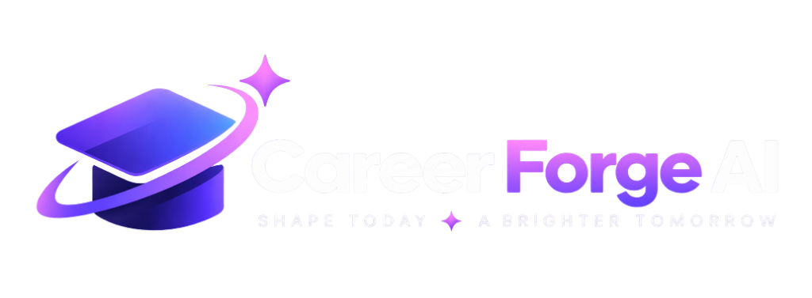
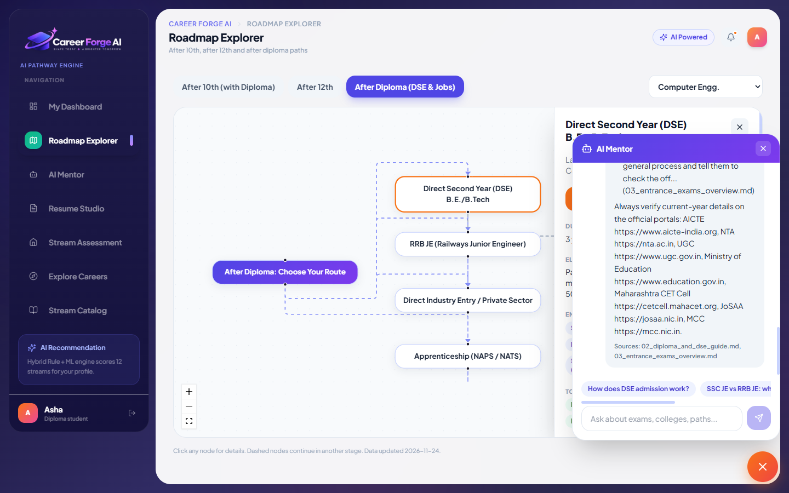
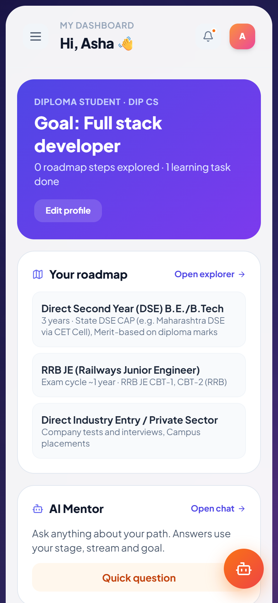
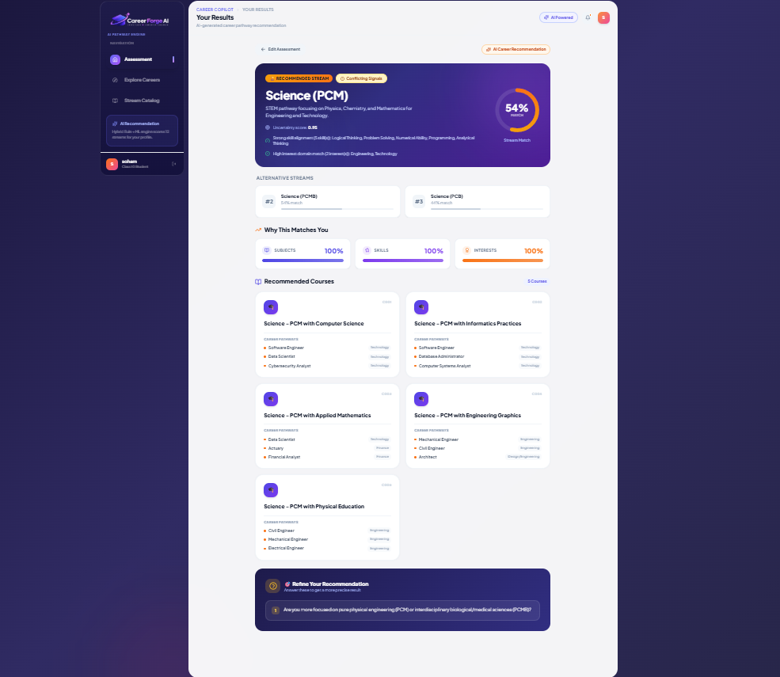
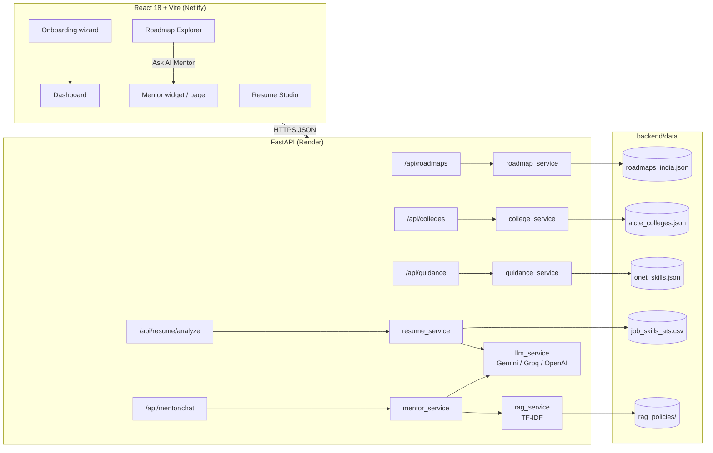

<div align="center">



# Career Forge AI

**Career guidance for Indian students after Class 10, Class 12 or a Diploma.**
Interactive education roadmaps, an AICTE college finder, a document-grounded AI Mentor and an ATS resume analyzer in one app.

[](https://github.com/sohans8/career-forge-ai/actions/workflows/ci.yml)
[](https://github.com/sohans8/career-forge-ai/actions/workflows/auto_sync_education.yml)


[**Live app**](https://dhruvsisodiya.netlify.app) · [**API**](https://career-copilot-api-9591.onrender.com) · [**API docs**](https://career-copilot-api-9591.onrender.com/docs) · [**Health**](https://career-copilot-api-9591.onrender.com/api/v1/health) · [**Architecture**](docs/ARCHITECTURE.md)

</div>


## Contents

- [Why it exists](#why-it-exists)
- [Features](#features)
- [Screenshots](#screenshots)
- [Live deployment](#live-deployment)
- [Quick start](#quick-start)
- [How it works](#how-it-works)
- [Datasets](#datasets)
- [API reference](#api-reference)
- [Automation](#automation)
- [Configuration](#configuration)
- [Testing](#testing)
- [Deployment](#deployment)
- [Project structure](#project-structure)
- [Limitations](#limitations)

## Why it exists

After Class 10, an Indian student has to choose between 11th Science, Commerce, Arts, a polytechnic diploma, ITI and vocational tracks. Each choice opens different entrance exams, lateral-entry routes and jobs. The information is spread across AICTE, NTA, state CET cells and dozens of college sites. Career Forge AI puts these paths on one map, links each step to the official source and lets the student ask follow-up questions about the step they are looking at.

## Features

| | Feature | What it does |
|---|---|---|
| 🧭 | **Onboarding and dashboard** | A five-step wizard records the student's stage, stream, RIASEC interests, strengths and goal. The dashboard then shows the best-matching O*NET careers, the next three roadmap steps, skills to build and next actions. Progress is saved in the browser. |
| 🗺️ | **Roadmap Explorer** | A React Flow graph of 37 pathway nodes across *after 10th*, *after 12th* and *after diploma*, with a stream filter. Each node opens a drawer with duration, eligibility, entrance exams, branches or roles, indicative salary, official links and matching AICTE colleges by state. Dashed nodes continue in another stage. |
| 🤖 | **AI Mentor** | Chat as a full page or as a floating widget. It knows the student's profile and the roadmap node being discussed, retrieves passages from a local policy library and cites them. It uses Gemini, Groq or OpenAI when a key is set and answers offline from the knowledge base when none is set. |
| 📄 | **Resume Studio** | Upload a PDF or DOCX, choose one of 16 target roles and get an ATS score (keywords, impact, formatting, completeness), matched and missing skills, section feedback, bullet rewrites and a learning checklist with free resources and mini projects. |
| 🏫 | **College search** | About 7,900 AICTE-listed engineering, diploma and management institutions, filterable by state, type, branch, district, ownership and name. |
| 📊 | **Stream recommender (v1)** | The original hybrid rule engine plus Logistic Regression model that ranks 12 Class 11 streams, with confidence status and follow-up questions. |
| 🔄 | **Self-updating data** | A weekly GitHub Actions job watches AICTE, UGC, NTA, CET Cell and MoE notices, collects new official PDFs, stages schema-checked data patches and opens a pull request for review. |

## Screenshots

| Roadmap Explorer with node drawer | AI Mentor about a roadmap node |
|---|---|
|  |  |

| Resume Studio | Mobile dashboard |
|---|---|
|  |  |

| Stream recommender (v1) results |
|---|
|  |

## Live deployment

| Service | URL |
|---|---|
| Frontend (Netlify) | https://dhruvsisodiya.netlify.app |
| Backend API (Render) | https://career-copilot-api-9591.onrender.com |
| API docs (Swagger) | https://career-copilot-api-9591.onrender.com/docs |
| Health check | https://career-copilot-api-9591.onrender.com/api/v1/health |

The backend runs on Render's free tier. After about 15 minutes without traffic it sleeps, and the next request takes 30 to 60 seconds. The frontend waits up to 60 seconds and shows a retry message if the server is still waking up.

## Quick start

Requirements: Python 3.11 and Node.js 20.

```bash
git clone https://github.com/sohans8/career-forge-ai.git
cd career-forge-ai

# Backend
python -m pip install -r backend/requirements-dev.txt
python -m uvicorn backend.app.main:app --reload --port 8000

# Frontend (second terminal)
cd frontend
npm install
npm run dev
```

Open http://localhost:5173. In development the frontend calls `http://127.0.0.1:8000` (set in `frontend/.env.development`). No API key is needed. To turn on LLM answers, copy `.env.example` to `backend/.env` and add a key (see [Configuration](#configuration)).

All derived datasets are committed, so the app runs straight after cloning. See [Datasets](#datasets) to rebuild them from raw sources.

## How it works



- **Roadmap.** The graph is a JSON knowledge base validated by a JSON Schema and graph checks: unique IDs, valid links and one root per stage.
- **Guidance.** Careers are ranked by a weighted score: 45% RIASEC interest fit, 20% overlap with strengths, 20% goal match, 15% stream fit.
- **Mentor.** Each question is answered from the student profile, the selected node, the last 8 chat turns and the top 4 retrieved passages. If the LLM provider fails, the offline answer is returned instead of an error.
- **Resume.** Scoring is deterministic and explainable. An LLM, when configured, only improves the rewrites and adds a summary.

The full design is in [docs/ARCHITECTURE.md](docs/ARCHITECTURE.md).

## Datasets

| # | File | Contents | Source |
|---|---|---|---|
| 1 | `roadmaps_india.json` | 37 pathway nodes with exams, eligibility, salaries, college types and official links | Curated seed (`seed_roadmaps.py`), updated through reviewed patches |
| 2 | `aicte_colleges.json` | About 7,900 institutions with state, district, ownership, programme types and branches | AICTE institutions-with-programmes dump |
| 3 | `onet_skills.json` | 923 occupations with RIASEC vectors, top skills and hot technologies | O*NET database |
| 4 | `job_skills_ats.csv` | Skill weights for 16 resume target roles | Kaggle / Hugging Face `batuhanmtl/job-skill-set` plus curated lists |
| 5 | `rag_policies/` | Policy notes on NEP 2020, diploma and DSE, and entrance exams, plus any PDFs the watcher collects | Curated, and official portals |

The large raw source files are git-ignored. `fetch_datasets.py` rebuilds each derived file from local raw files, then a remote source, then a built-in seed:

```bash
python -m backend.scripts.fetch_datasets            # build what is missing
python -m backend.scripts.fetch_datasets --force    # rebuild everything
python -m backend.scripts.fetch_datasets --audit    # show what is present
python -m backend.scripts.validate_data             # schema and integrity checks
```

Pharmacy colleges are approved by the Pharmacy Council of India rather than AICTE, so they are not in the college list. The pharmacy roadmap nodes link to pci.nic.in instead.

## API reference

Interactive docs: [`/docs`](https://career-copilot-api-9591.onrender.com/docs).

| Method | Path | Purpose |
|---|---|---|
| GET | `/api/v1/health` | Health check, returns `{"status":"ok"}` |
| GET | `/api/status` | Dataset counts, RAG index size and LLM provider (never keys) |
| GET | `/api/roadmaps?stage=&stream=` | Graph for `after_10th`, `after_12th` or `after_diploma`, optional stream filter |
| GET | `/api/roadmaps/meta` | Schema version, last update and stage list |
| GET | `/api/roadmaps/nodes/{id}` | One node |
| GET | `/api/colleges` | Search with `state`, `type`, `branch`, `district`, `ownership`, `q`, `limit` (1 to 100), `offset` |
| GET | `/api/colleges/states` | States with listed colleges |
| GET | `/api/guidance/quiz` | Onboarding quiz |
| POST | `/api/guidance/recommend` | Dashboard from `stage`, `stream`, `interests`, `strengths`, `career_goal`, `name` |
| POST | `/api/mentor/chat` | `{message, history, profile, node_id}` → `{reply, sources, llm_used, provider}` |
| GET | `/api/mentor/prompts?stage=` | Suggested questions for a stage |
| GET | `/api/resume/roles` | Target roles |
| POST | `/api/resume/analyze` | Multipart `file` (PDF/DOCX, up to 5 MB) and `target_role` |
| POST | `/api/v1/recommend` | v1 stream recommendation |

```bash
curl -X POST https://career-copilot-api-9591.onrender.com/api/mentor/chat \
  -H "Content-Type: application/json" \
  -d '{"message":"How does DSE admission work?","node_id":"ad_dse","profile":{"stage":"after_diploma","stream":"dip_cs"}}'
```

## Automation

| What | When | Where |
|---|---|---|
| **CI**: dataset validation, 38 backend tests, a server smoke test and the frontend production build | Every push and pull request | `.github/workflows/ci.yml` |
| **Education data sync**: watch official portals, collect PDFs, stage patches, reindex, open a PR | Mondays 03:30 UTC, or manually | `.github/workflows/auto_sync_education.yml` |
| **Backend deploy** | On push to the branch the Render service tracks (`feature/backend-api` in `render.yaml`) | `render.yaml`, `.python-version` |
| **Frontend deploy** | On push, once the repo is connected to a Netlify site | `netlify.toml` |

The sync job never edits live data on its own. `backend/scripts/update_education_data.py`:

1. Fetches notice pages and keeps only those whose content hash changed.
2. Downloads at most 5 new PDFs per run (25 MB each) over HTTPS from an allow-list of official domains.
3. If an LLM key is set, extracts JSON patches. Fetched text is treated as untrusted. Patches must be updates to existing nodes, may only change a fixed list of fields and must keep the graph valid.
4. Writes patches to `backend/data/staged_patches/` as `pending` and rebuilds the Mentor's index.

The workflow then re-validates, runs the tests and opens a PR on `bot/education-sync`. A reviewer sets `"status": "approved"` and applies a patch with:

```bash
python -m backend.scripts.update_education_data --apply backend/data/staged_patches/<file>.json
```

Applying writes a dated backup of the roadmap first. LLM keys for the workflow come from the repository secrets `GEMINI_API_KEY`, `GROQ_API_KEY` and `OPENAI_API_KEY`. All are optional.

## Configuration

Backend settings come from environment variables, `backend/.env` or a root `.env`. `.env` files are git-ignored; never commit keys.

| Variable | Default | Purpose |
|---|---|---|
| `LLM_PROVIDER` | `auto` | `auto` uses the first key found (Gemini, Groq, OpenAI), or force `gemini`, `groq`, `openai` |
| `GEMINI_API_KEY` / `GROQ_API_KEY` / `OPENAI_API_KEY` | empty | Provider keys |
| `GEMINI_MODEL` | `gemini-2.0-flash` | Model override |
| `GROQ_MODEL` | `llama-3.3-70b-versatile` | Model override |
| `OPENAI_MODEL` | `gpt-4o-mini` | Model override |
| `LLM_TIMEOUT_SECONDS` | `45` | LLM request timeout |
| `CORS_ORIGINS` | `*` | Comma-separated allowed origins |
| `MAX_UPLOAD_MB` | `5` | Resume upload limit |
| `DATA_DIR` | `backend/data` | Alternative data folder |

Frontend: `VITE_API_BASE_URL` (default `https://career-copilot-api-9591.onrender.com`). Development uses `frontend/.env.development` and production uses `frontend/.env.production` or the Netlify dashboard.

## Testing

```bash
python -m pytest backend/tests -q        # 38 tests, no network or keys needed
python -m backend.scripts.validate_data
cd frontend && npm run build
```

The tests cover dataset validation and the watcher's safety rules (domain allow-list, field filtering, approval before apply). They also cover the roadmap and college endpoints, including a check that every node offering a college list matches real colleges, plus guidance, the mentor in offline and LLM modes, RAG chunking, and resume parsing, scoring and upload limits.

## Deployment

**Backend on Render.** `render.yaml` describes the service: `pip install -r backend/requirements.txt`, then `python -m uvicorn backend.app.main:app --host 0.0.0.0 --port $PORT`, health check `/api/v1/health`, Python 3.11.9, auto-deploy on. For a new service choose *New → Blueprint* and select this repo. For the existing service, check that its build and start commands match. Add an LLM key in the Render environment to turn on AI answers.

**Frontend on Netlify.** `netlify.toml` builds `frontend/` with Node 20, publishes `dist` and sends every route to `index.html`. Connect the repo under *Add new site → Import an existing project*. Netlify then reads these settings and redeploys on every push. Set `VITE_API_BASE_URL` there if the backend URL changes.

## Project structure

```
backend/
  app/            FastAPI app: main.py, config.py, routes/, services/, models/
  data/           five datasets, JSON schema, v1 CSVs in raw/
  scripts/        fetch_datasets, seed_roadmaps, validate_data, update_education_data
  ml/             v1 stream classifier: training, evaluation, robustness study
  tests/          pytest suite
frontend/src/
  pages/          StudentDashboard, RoadmapPage, MentorPage, ResumePage
  components/     OnboardingWizard, MentorChat, MentorWidget, Sidebar, Header
  context/        ProfileContext (localStorage), MentorContext
  views/          v1 assessment, results, streams and careers views
  services/       api.js (Axios client)
.github/workflows/  ci.yml, auto_sync_education.yml
docs/             ARCHITECTURE.md, project report, screenshots
render.yaml · netlify.toml · .python-version · .env.example
```

## Limitations

- Exam patterns, cut-offs and salaries change every year. Values are indicative, and every node links to its official source.
- The college list covers AICTE-approved institutions only. Pharmacy, medical, law and many university colleges are approved by other bodies.
- The v1 stream classifier was trained on synthetic profiles.
- There are no accounts. Progress lives in the browser's `localStorage`.
- English only.

## Data sources and credits

AICTE institution data · O*NET database (U.S. Department of Labor, CC BY 4.0) · `batuhanmtl/job-skill-set` on Hugging Face · roadmap.sh · official portals of AICTE, NTA, UGC, Ministry of Education, Maharashtra CET Cell, PCI and DGT.
