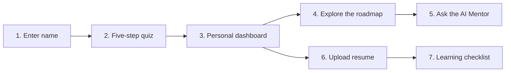
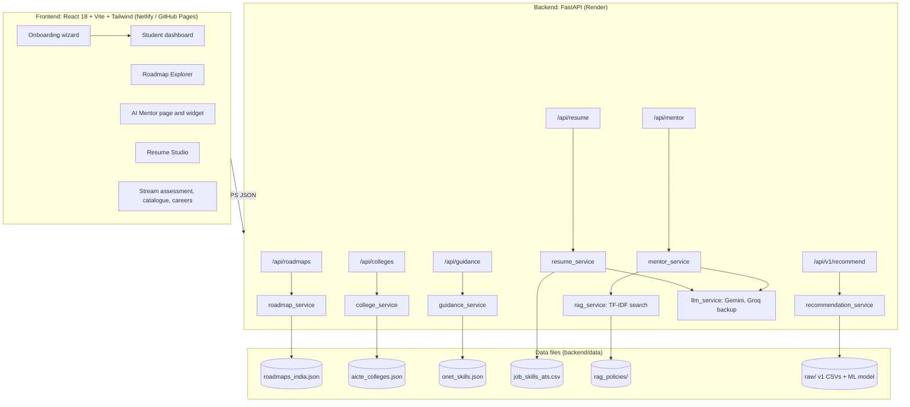
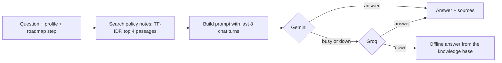

<div align="center">


# Career Forge AI

### Your career path after 10th, 12th or Diploma, on one map, with an AI mentor.

Explore every route, find AICTE colleges, ask questions and get your resume ATS-ready.

<br />

<a href="https://career-forge-ai-yprq.netlify.app/"></a>
&nbsp;
<a href="https://career-copilot-api-lw76.onrender.com/docs"></a>
&nbsp;
<a href="docs/ARCHITECTURE.md"></a>

<br /><br />

[](https://github.com/sohans8/career-forge-ai/actions/workflows/ci.yml)


<br />


</div>

<br />

## 📑 Contents

1. [About the project](#-about-the-project)
2. [How a student uses it](#-how-a-student-uses-it)
3. [Features](#-features)
4. [Screenshots](#-screenshots)
5. [Live links](#-live-links)
6. [Architecture](#-architecture)
7. [How the intelligence works](#-how-the-intelligence-works)
8. [Datasets](#-datasets)
9. [Tech stack](#-tech-stack)
10. [Project structure](#-project-structure)
11. [Run it locally](#-run-it-locally)
12. [Configuration](#-configuration)
13. [API reference](#-api-reference)
14. [Testing and CI](#-testing-and-ci)
15. [Automation](#-automation)
16. [Deployment](#-deployment)
17. [Limitations and future scope](#-limitations-and-future-scope)
18. [Data sources, license and author](#-data-sources)

---

## 🎯 About the project

### The problem

After Class 10, an Indian student has to choose between 11th Science, Commerce or Arts, a polytechnic diploma, ITI or a vocational track. After Class 12 or a diploma, the choices multiply again: engineering, medicine, law, design, CA, Direct Second Year (DSE) lateral entry, government Junior Engineer jobs and apprenticeships.

The information needed for these decisions is spread across AICTE, NTA, UGC, state CET cells, the Ministry of Education and hundreds of college websites. Most students decide based on what friends or relatives did, without seeing the full picture.

### The solution

Career Forge AI puts every path on one interactive map and helps the student act on it:

- **See every route** after 10th, 12th or a diploma, with eligibility, entrance exams, duration, salary and official links.
- **Find real colleges** for each route from the AICTE list.
- **Ask an AI mentor** that knows the student's profile and the step they are looking at, and cites official policy notes.
- **Get matched careers** from a short interest and strengths quiz.
- **Make the resume job-ready** with an ATS score and a free learning plan.

### Who it is for

- **Students** in Class 10, Class 12 or a diploma who want to plan their next step.
- **Parents and teachers** who guide them.
- **Counsellors** who need one place with verified paths and official sources.

---

## 🧭 How a student uses it



1. **Start:** the student enters their name on the landing page.
2. **Quiz:** five quick steps covering stage (after 10th, after 12th or after diploma), stream, interests (RIASEC types such as Hands-on or Investigative), strengths (such as Maths or Programming) and a career goal.
3. **Dashboard:** shows the top matching careers with match %, the next three roadmap steps, skills to build and next actions.
4. **Roadmap Explorer:** an interactive graph of every route for their stage. Clicking a step opens its details and matching colleges.
5. **AI Mentor:** "Ask AI Mentor about this path" opens a chat already filled in with a question about that step.
6. **Resume Studio:** upload a resume, pick a target role and get a score with improvements.
7. **Progress:** explored steps, the checklist and the resume score are saved in the browser, so the student can come back later.

---

## ✨ Features

### 🗺️ Roadmap Explorer
- **37 steps** across three stages: after 10th (Science PCM/PCB, Commerce, Arts, 8 diploma branches, ITI, vocational), after 12th (B.Tech, emerging-tech degrees, MBBS, pharmacy, B.Com, BBA, CA, CS, law, design, BA/B.Sc, defence) and after diploma (DSE, SSC JE, RRB JE, state JE/PSU jobs, private sector, apprenticeships, higher studies).
- **Stream filter:** shows only the steps that fit the student's stream, for example Diploma Computer Engineering.
- **Step details:** duration, eligibility, entrance exams, top branches or roles, indicative salary, official links and the last update date.
- **Matching colleges:** AICTE institutions for that step, filterable by state.
- **Cross-stage links:** dashed nodes show where a path continues into the next stage, and clicking them jumps there.
- **Progress:** each step can be marked as explored.

### 🤖 AI Mentor
- Available as a full page and as a floating chat button on every page.
- Uses the student's stage, stream, goal and the roadmap step being discussed.
- Answers are built from official policy notes (NEP 2020, diploma and DSE rules, entrance exams), and each answer lists its sources.
- Suggested questions for each stage, for example "How does DSE admission work?".
- Powered by Gemini, with Groq as an automatic backup and an offline answer if no AI is reachable.

### 📄 Resume Studio
- Upload a **PDF or DOCX** (up to 5 MB). The file is analysed in memory and not stored.
- Choose one of **16 target roles**: Software Developer, Full Stack Developer, AI/ML Engineer, Data Scientist, Data Analyst, Mechanical, Civil, Electrical and Electronics Engineer, Diploma Engineer (Fresher), Information Technology, Finance, Finance / Accounting, Sales, Business Development and HR.
- **ATS score out of 100** with four parts: keywords, impact, formatting and completeness.
- **Matched and missing skills** for the role.
- **Section feedback** and **bullet rewrites** with a strong action verb and a measurable result.
- **Learning checklist:** each missing skill comes with free resources (roadmap.sh, SWAYAM/NPTEL, Coursera audit, YouTube) and a mini-project idea.

### 🎯 Career matching
- Ranks **923 careers** from the U.S. O*NET database using the student's interests, strengths, goal and stream.
- Shows the match % (always between 0 and 100), key skills and in-demand technologies for each career.

### 🏫 College search
- About **7,900 AICTE-listed institutions**: 3,585 diploma, 2,959 engineering and 3,465 management.
- Filter by state, type, branch, district, ownership and name.

### 📊 Class 10 stream recommender
- The original assessment: pick favourite subjects, skills and interests, and get the best of 12 Class 11 streams with a confidence level and follow-up questions.
- Also includes a stream catalogue and a career explorer.

### 🔄 Self-updating education data
- Every Monday, a GitHub Actions job checks AICTE, UGC, NTA, Maharashtra CET Cell and Ministry of Education pages for changes.
- New official PDFs are added to the mentor's library, and proposed data changes are opened as a pull request for a human to approve.

### 📱 Works everywhere
- Responsive on phones, tablets and desktops. No sign-up needed; progress is saved in the browser.

---

## 📸 Screenshots

<table>
  <tr>
    <td width="50%" align="center"><b>Roadmap Explorer</b><br /><br /></td>
    <td width="50%" align="center"><b>AI Mentor on a roadmap step</b><br /><br /></td>
  </tr>
  <tr>
    <td width="50%" align="center"><b>Resume Studio</b><br /><br /></td>
    <td width="50%" align="center"><b>Stream recommender results</b><br /><br /></td>
  </tr>
</table>

<table>
  <tr>
    <td width="30%" align="center"></td>
    <td width="70%" valign="middle">
      <h3>📱 Works on phones</h3>
      <p>Every page adapts to small screens. Progress is saved in the browser, so students can close the app and continue later.</p>
    </td>
  </tr>
</table>

---

## 🔗 Live links

| | Link |
|---|---|
| 🌐 **App (Netlify)** | https://career-forge-ai-yprq.netlify.app/ |
| 🌐 **App (GitHub Pages)** | https://sohans8.github.io/career-forge-ai/ |
| ⚙️ **API** | https://career-copilot-api-lw76.onrender.com |
| 📘 **API docs (Swagger)** | https://career-copilot-api-lw76.onrender.com/docs |
| ❤️ **Health check** | https://career-copilot-api-lw76.onrender.com/api/v1/health |

> [!NOTE]
> The API runs on Render's free plan. It sleeps after about 15 minutes without visitors, so the first visit after that can take up to a minute. After that it is fast.

---

## 🏗️ Architecture



| Layer | What it does |
|---|---|
| **Frontend** | A single-page React app. `ProfileContext` keeps the profile, dashboard, resume score, checklist and explored steps in `localStorage`. `MentorContext` holds the chat and the roadmap step being asked about. All calls go through `services/api.js` (Axios, 60-second timeout for Render wake-ups). |
| **Backend** | FastAPI with one router per area and one service per job. There is no database: data files load into memory on first use, which keeps responses fast and hosting free. Input is validated with Pydantic, for example message length, upload size and allowed stages. |
| **Data** | Five compact datasets built from public sources by `fetch_datasets.py` and checked by `validate_data.py`. |
| **AI** | `llm_service` calls Gemini, Groq or OpenAI over HTTPS with automatic fallback. No AI SDKs are needed. |
| **Automation** | GitHub Actions runs the tests on every push and the education-data watcher every Monday. |

More detail: [docs/ARCHITECTURE.md](docs/ARCHITECTURE.md).

---

## 🧠 How the intelligence works

### Career matching (dashboard)

Each of the 923 O*NET careers gets a score from 0 to 100%:

| Part | Weight | How it is measured |
|---|---|---|
| Interest fit | 45% | The career's RIASEC profile (O*NET 1–7 scale mapped to 0–1), weighted 1.0 / 0.8 / 0.6 for the student's 1st, 2nd and 3rd interest |
| Strengths | 20% | Share of the student's strengths (mapped to O*NET skills) that the career needs |
| Goal | 20% | Whether words from the student's career goal appear in the career title |
| Stream fit | 15% | Whether the career belongs to an occupation group that suits the student's stream |

The top 6 careers are shown, together with the most common skill gaps among them and the resume role that best matches the goal.

### Roadmap

The roadmap is a JSON graph. Every step lists its `next_nodes`, so the app draws the arrows from data. A JSON Schema plus integrity checks (unique IDs, valid links, one starting point per stage) run in CI. The stream filter keeps only the steps tagged for that stream, and steps in another stage appear as dashed links.

### AI Mentor



- **Retrieval:** policy notes and PDFs in `backend/data/rag_policies/` are split into overlapping chunks and indexed with scikit-learn TF-IDF. The index rebuilds automatically when files change.
- **Prompt:** the system prompt contains the student's stage, stream and goal, the selected roadmap step and the retrieved passages, and tells the model to point to official portals.
- **Reliability:** if a provider fails, the next one is tried. If a provider has retired a model, the app asks the provider for its current models, switches to a suitable one and remembers it. If no AI is reachable, the student still gets an answer built from the roadmap step and the notes.

### Resume ATS score

| Part | Weight | What is checked |
|---|---|---|
| Keywords | 40% | Weighted share of the target role's skills found in the resume (whole-word match with synonyms) |
| Impact | 25% | Share of bullet points that start with a strong action verb and contain a number or measurable result |
| Formatting | 20% | Email, phone, LinkedIn/GitHub links, length of 250–900 words, at least 4 bullets, clear sections |
| Completeness | 15% | Education, skills, projects, experience, summary, certifications and achievements sections |

The score is rule-based and explainable, so it gives the same result every time. AI only improves the bullet rewrites and adds a short summary.

### Class 10 stream recommender

- **Rule engine:** scores each of 12 streams with 40% skills, 40% interests and 20% subjects.
- **ML model:** a calibrated Logistic Regression on 240 binary features (105 subjects, 76 skills, 59 interests), trained on 600 synthetic student profiles.
- **Hybrid:** combines both. Sparse inputs lean on the rules (85% rules, 15% model); complete inputs use 50/50.
- **Confidence:** each result is labelled high confidence, moderate confidence, conflicting evidence or needs more information. Unclear cases come with follow-up questions.
- **Held-out test (120 profiles):** rule engine 91.67% top-1; model and hybrid 100% top-1. The data is synthetic, so real-world accuracy will be lower. Details are in [backend/ml/README.md](backend/ml/README.md).

---

## 📊 Datasets

| File | What it holds | Source |
|---|---|---|
| `roadmaps_india.json` | 37 steps with exams, eligibility, durations, salaries, streams, college types and official links | Curated (`seed_roadmaps.py`), updated through reviewed patches |
| `aicte_colleges.json` | About 7,900 institutions with state, district, ownership, programme types, branches and intake | AICTE institutions-with-programmes list |
| `onet_skills.json` | 923 careers with RIASEC profiles, top skills and hot technologies | O*NET database (U.S. Department of Labor) |
| `job_skills_ats.csv` | Weighted skills for 16 resume roles | Hugging Face `batuhanmtl/job-skill-set` plus curated lists |
| `rag_policies/` | Notes on NEP 2020, diploma and DSE, and entrance exams, plus PDFs collected by the watcher | Curated and official portals |
| `raw/career_copilot_expanded_dataset/` | Class 10 recommender catalogue: 12 streams, 105 subjects, 76 skills, 59 interests, 104 courses, 200 careers, 1,250 rules | Curated |

The large raw source files are not stored in the repo (see `.gitignore`). Only the compact derived files are. To rebuild and check:

```bash
python -m backend.scripts.fetch_datasets            # build what is missing
python -m backend.scripts.fetch_datasets --force    # rebuild everything
python -m backend.scripts.fetch_datasets --audit    # show what is present
python -m backend.scripts.validate_data             # schema and integrity checks
```

Each builder uses local raw files first, then a public online source, then a small built-in sample, so the app always starts. Pharmacy colleges are approved by the Pharmacy Council of India rather than AICTE, so the pharmacy steps link to pci.nic.in instead of listing colleges.

---

## 🛠️ Tech stack

| Area | Technology |
|---|---|
| Frontend | React 18, Vite 6, Tailwind CSS 3, React Flow (graph), Axios, Lucide icons |
| Backend | Python 3.11, FastAPI, Uvicorn, Pydantic 2, httpx |
| Machine learning and search | scikit-learn (Logistic Regression, TF-IDF), pandas, NumPy, joblib |
| Documents | pypdf, python-docx |
| AI providers | Google Gemini, Groq (OpenAI also supported) |
| Data checks | jsonschema |
| Testing and CI | pytest, GitHub Actions |
| Hosting | Netlify and GitHub Pages (frontend), Render (backend) |

---

## 📁 Project structure

```
career-forge-ai/
├── backend/
│   ├── app/
│   │   ├── main.py                 FastAPI app, CORS, error handlers, routers
│   │   ├── config.py               settings from environment variables
│   │   ├── routes/
│   │   │   ├── platform.py         roadmaps, colleges, mentor, resume, guidance, status
│   │   │   └── recommendation.py   Class 10 stream recommender
│   │   ├── services/
│   │   │   ├── roadmap_service.py  graph loading and stream filtering
│   │   │   ├── college_service.py  AICTE college search
│   │   │   ├── guidance_service.py quiz and career matching
│   │   │   ├── mentor_service.py   AI Mentor prompt, answer and offline fallback
│   │   │   ├── rag_service.py      TF-IDF search over policy notes
│   │   │   ├── llm_service.py      Gemini / Groq / OpenAI with fallback
│   │   │   ├── resume_service.py   resume parsing, ATS score, learning plan
│   │   │   └── recommendation_service.py  hybrid rule + ML stream recommender
│   │   └── models/schemas.py       request and response models
│   ├── data/                       the datasets, JSON schema and policy notes
│   ├── scripts/
│   │   ├── fetch_datasets.py       builds the datasets
│   │   ├── seed_roadmaps.py        builds the roadmap graph
│   │   ├── validate_data.py        checks every dataset
│   │   └── update_education_data.py  weekly education-notice watcher
│   ├── ml/                         training, evaluation and robustness study
│   └── tests/                      47 pytest tests
├── frontend/
│   └── src/
│       ├── pages/                  StudentDashboard, RoadmapPage, MentorPage, ResumePage
│       ├── components/             OnboardingWizard, MentorChat, MentorWidget, Sidebar, Header
│       ├── context/                ProfileContext, MentorContext
│       ├── views/                  Class 10 assessment, results, streams, careers
│       ├── data/                   quiz fallback and option lists
│       └── services/api.js         API client
├── docs/                           ARCHITECTURE.md, project report, screenshots
├── .github/workflows/              ci.yml, auto_sync_education.yml
├── render.yaml                     Render backend settings
├── netlify.toml                    Netlify frontend settings
├── requirements.txt                points to backend/requirements.txt
├── .env.example                    list of settings
└── LICENSE
```

---

## 🚀 Run it locally

You need **Python 3.11** and **Node.js 20**.

```bash
git clone https://github.com/sohans8/career-forge-ai.git
cd career-forge-ai

# 1. Start the backend (http://127.0.0.1:8000)
python -m pip install -r backend/requirements-dev.txt
python -m uvicorn backend.app.main:app --reload --port 8000

# 2. Start the frontend in a second terminal (http://localhost:5173)
cd frontend
npm install
npm run dev
```

All data is already in the repo, so nothing else needs downloading. In development the frontend calls the local backend (set in `frontend/.env.development`). To use AI locally, copy `.env.example` to `backend/.env` and add a key.

---

## ⚙️ Configuration

Set these on the host (for example Render → Environment) or in `backend/.env` for local use. Keys are never stored in the repo.

| Name | Default | What it does |
|---|---|---|
| `GEMINI_API_KEY` | not set | Google Gemini key ([get one](https://aistudio.google.com/apikey), free tier) |
| `GROQ_API_KEY` | not set | Groq key ([get one](https://console.groq.com/keys), free tier) |
| `OPENAI_API_KEY` | not set | OpenAI key ([get one](https://platform.openai.com/api-keys), paid) |
| `LLM_PROVIDER` | `auto` | `auto` uses the first key it finds. Set `gemini`, `groq` or `openai` to choose one |
| `GEMINI_MODEL` | `gemini-2.0-flash` | Starting Gemini model. If the provider retires it, the app switches to a current one automatically |
| `GROQ_MODEL` | `llama-3.3-70b-versatile` | Starting Groq model, switched the same way |
| `OPENAI_MODEL` | `gpt-4o-mini` | Starting OpenAI model |
| `LLM_TIMEOUT_SECONDS` | `45` | How long to wait for the AI |
| `CORS_ORIGINS` | `*` | Websites allowed to call the API |
| `MAX_UPLOAD_MB` | `5` | Largest resume upload |
| `DATA_DIR` | `backend/data` | Alternative data folder |
| `VITE_API_BASE_URL` | Render API address | Frontend: which API to call |

---

## 🔌 API reference

Try every endpoint in the browser at [/docs](https://career-copilot-api-lw76.onrender.com/docs).

| Method | Path | What it does |
|---|---|---|
| GET | `/api/v1/health` | Health check, returns `{"status": "ok"}` |
| GET | `/api/status` | Dataset counts, search index size and AI status (never keys) |
| GET | `/api/guidance/quiz` | Onboarding quiz: stages, streams, interests, strengths |
| POST | `/api/guidance/recommend` | Dashboard: top careers, roadmap steps, skills to build, next actions |
| GET | `/api/roadmaps?stage=&stream=` | Roadmap graph for `after_10th`, `after_12th` or `after_diploma` |
| GET | `/api/roadmaps/meta` | Version, last update and stage list |
| GET | `/api/roadmaps/nodes/{id}` | One roadmap step |
| GET | `/api/colleges` | College search: `state`, `type`, `branch`, `district`, `ownership`, `q`, `limit` (1–100), `offset` |
| GET | `/api/colleges/states` | States with listed colleges |
| POST | `/api/mentor/chat` | Ask the AI Mentor |
| GET | `/api/mentor/prompts?stage=` | Suggested questions for a stage |
| GET | `/api/resume/roles` | The 16 target roles |
| POST | `/api/resume/analyze` | Upload a PDF/DOCX `file` with a `target_role` |
| POST | `/api/v1/recommend` | Class 10 stream recommendation |

**Example: ask the AI Mentor**

```bash
curl -X POST https://career-copilot-api-lw76.onrender.com/api/mentor/chat \
  -H "Content-Type: application/json" \
  -d '{"message": "How does DSE admission work?", "node_id": "ad_dse",
       "profile": {"stage": "after_diploma", "stream": "dip_cs"}}'
```

```json
{
  "reply": "Direct Second Year (DSE) lets diploma holders join the second year of B.E./B.Tech ...",
  "sources": ["02_diploma_and_dse_guide.md"],
  "llm_used": true,
  "provider": "gemini"
}
```

**Example: personal dashboard**

```bash
curl -X POST https://career-copilot-api-lw76.onrender.com/api/guidance/recommend \
  -H "Content-Type: application/json" \
  -d '{"stage": "after_diploma", "stream": "dip_cs", "interests": ["I", "R"],
       "strengths": ["programming"], "career_goal": "Full stack developer"}'
```

Returns `top_careers` (title, match %, skills), `recommended_roadmap`, `skill_gap_summary`, `next_actions` and `suggested_resume_role`.

---

## 🧪 Testing and CI

```bash
python -m pytest backend/tests -q        # 47 tests, no internet or keys needed
python -m backend.scripts.validate_data  # dataset checks
cd frontend && npm run build             # production build
```

| Test file | What it covers |
|---|---|
| `test_roadmaps_colleges.py` | Every stage returns a valid graph, stream filters, required fields, invalid input, college search and paging, every step with a college list matches real colleges |
| `test_guidance_mentor.py` | Quiz, career matching (scores always 0–100%), the mentor with and without AI, provider fallback, retired-model switching, citation clean-up, status and health |
| `test_resume.py` | PDF and DOCX reading, skill matching, bullet rewrites, upload limits and wrong file types |
| `test_data_pipeline.py` | Dataset validation and the watcher's safety rules: allowed domains, field filtering and approval before apply |

**GitHub Actions (`ci.yml`)** runs on every push and pull request. It installs the backend, validates the data, runs all tests, starts the server and calls the main endpoints, then builds the frontend. The badge at the top shows the latest result.

---

## 🔄 Automation

| What | When | File |
|---|---|---|
| Tests, data checks and build | Every push and pull request | `.github/workflows/ci.yml` |
| Education notice watcher | Every Monday 09:00 IST, or manually | `.github/workflows/auto_sync_education.yml` |
| Backend deploy | Every push (Render auto-deploy) | `render.yaml` |
| Frontend deploy | Every push (Netlify) | `netlify.toml` |

**How the weekly watcher works** (`backend/scripts/update_education_data.py`):

1. **Watch:** fetch AICTE, UGC, NTA, CET Cell and Ministry of Education pages and keep only those whose content changed.
2. **Collect:** download up to 5 new PDFs per run (25 MB each), only over HTTPS from official government domains.
3. **Extract:** an AI model turns changed notices into proposed data changes. Fetched text is treated as untrusted: changes may only update existing steps and a fixed list of fields, and must keep the graph valid.
4. **Stage:** proposed changes are saved as `pending`, and the mentor's search index is rebuilt.
5. **Review:** the workflow opens a pull request. Nothing reaches the live data until a person approves it:

```bash
python -m backend.scripts.update_education_data --apply backend/data/staged_patches/<file>.json
```

---

## ☁️ Deployment

| Part | Host | Build | Start |
|---|---|---|---|
| Backend | Render (free plan) | `pip install -r requirements.txt` | `python -m uvicorn backend.app.main:app --host 0.0.0.0 --port $PORT` |
| Frontend | Netlify | `npm run build` in `frontend/` | static files from `frontend/dist` |
| Frontend mirror | GitHub Pages (`gh-pages` branch) | `npx vite build --base=/career-forge-ai/` | static files |

- **Render:** `render.yaml` holds the full service definition, including the health check at `/api/v1/health` and Python 3.11 from `.python-version`. AI keys are added in the Render dashboard under Environment.
- **Netlify:** `netlify.toml` sets the build folder, Node 20 and the rule that sends every route to `index.html`.
- **Data:** all derived data is in the repo, so no download step runs at deploy time.

---

## 🧩 Limitations and future scope

**Current limitations**
- Exam rules, cut-offs and salaries change every year. Values are indicative, and each step links to its official source.
- College search covers AICTE-approved institutions only. Medical, pharmacy, law and many university colleges are approved by other bodies.
- The Class 10 stream model was trained on synthetic profiles.
- Progress is stored in the browser. There are no user accounts yet.
- The content is in English only.

**Ideas for future work**
- User accounts so progress syncs across devices.
- Hindi and Marathi versions.
- More states' admission rules and NIRF rankings in college search.
- Real, anonymised student outcomes to retrain the stream model.

---

## 🙏 Data sources

AICTE · O*NET (U.S. Department of Labor, CC BY 4.0) · Hugging Face `batuhanmtl/job-skill-set` · roadmap.sh · official portals of NTA, UGC, Ministry of Education, Maharashtra CET Cell, PCI and DGT.

## 📄 License

Released under the [MIT License](LICENSE).


